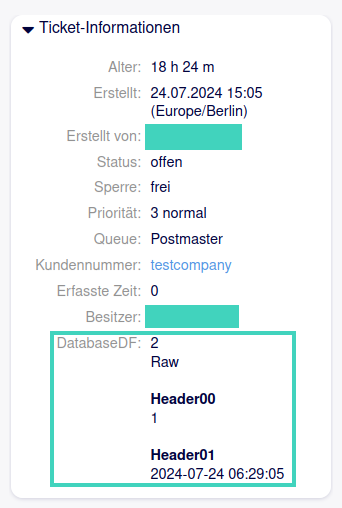
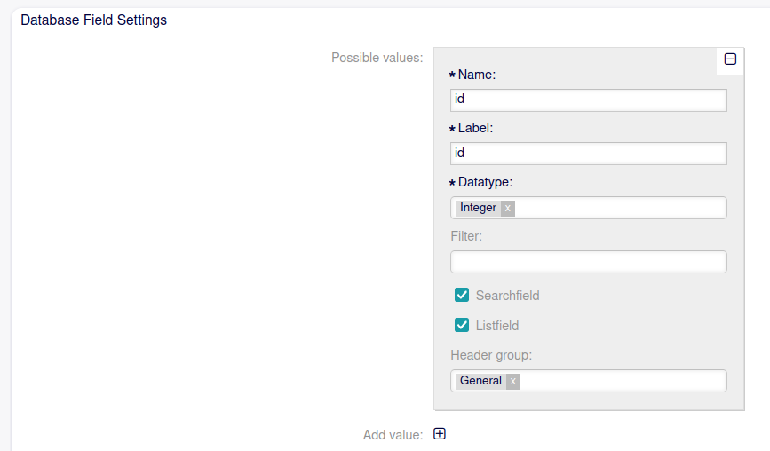

.. toctree::
    :maxdepth: 2
    :caption: Contents

Sacrifice to Sphinx
===================

Description
===========
The package DynamicFieldDatabaseExtensions provides the possibility to extend the information displayed by dynamic field database values.

System requirements
===================

Framework
---------
OTOBO 11.0.x

Packages
--------
\-

Third-party software
--------------------
\-

Usage
=====
After installation and activating the system configuration, a dropdown is added to the possible values elements in the AdminDynamicFieldDB screen (see picture 2). There you can choose a header under which the possible value should be layouted. An example layout of the TicketInformation widget in AgentTicketZoom is shown in picture 1.

   The screenshot shows a layout example in the TicketInformation widget.

   The screenshot shows the newly available header dropdown in AdminDynamicFieldDB.

Setup
-----
To activate the package functionality, the newly added system configuration setting DynamicFieldDB::DisplayFieldHeaders needs to be activated. In the setting, you can define a list of headers to group dynamic field database possible values by. Notice that, despite not being present in the setting, the header General is always displayed in the newly added dropdown in the possible values elements in AdminDynamicFieldDB. Also, the entire feature will only be active if the system configuration setting is activated.

Configuration Reference
-----------------------

Core::Ticket
^^^^^^^^^^^^^^^^^^^^^^^^^^^^^^^^^^^^^^^^^^^^^^^^^^^^^^^^^^^^^^^^^^^^^^^^^^^^^^^^^^^^^^^^^^^^^^^^^^^^^^^^^^^^^^^^^^^^^^^^^^^^^^

DynamicFieldDB::DisplayfieldHeaders
""""""""""""""""""""""""""""""""""""""""""""""""""""""""""""""""""""""""""""""""""""""""""""""""""""""""""""""""""""""""""""""
Define a list of headers to group dynamic field database possible values by. Notice: Header 'General' is always added if not defined.

About
=======

Contact
-------
| Rother OSS GmbH
| Email: hello@otobo.io
| Web: https://otobo.io

Version
-------
Author: |doc-vendor| / Version: |doc-version| / Date of release: |doc-datestamp|
